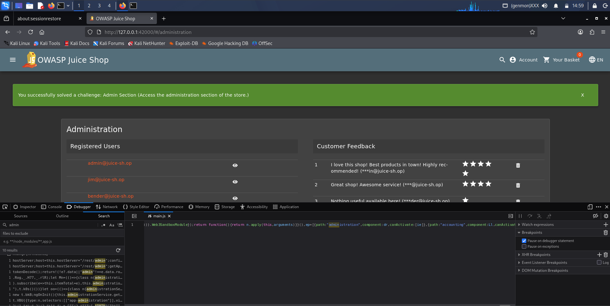

# Admin Section

**Category:** Broken Access Control  
**Difficulty:** ⭐⭐⭐  
**Assignee:** Emmanuel Oshike  
**Status:** [x] Completed  

## Objective
Access the administration section of the store.

## Tools Used
* Web browser Developer Tools (F12)
* URL Manipulation

## Analysis & Approach
Many modern Single Page Applications (SPAs) like the Juice Shop rely on client-side routing (e.g., Angular Router). Developers sometimes attempt to secure administrative interfaces by simply removing the visible navigation buttons for non-admin users ("Security by Obscurity"). However, the routing paths themselves remain defined in the client-side JavaScript bundle sent to every user's browser. By inspecting the frontend code, we can discover the hidden administrative URL and navigate to it directly.

## Steps to Reproduce
1. Navigate to the Juice Shop in your browser.
2. Open Developer Tools (press `F12`) and navigate to the **Debugger** or **Sources** tab.
3. Open the main application bundle (e.g., `main.js`).
4. Search the file (using `Ctrl+F`) for routing keywords like `path:` or the word `admin`. 
5. You will locate a routing configuration that maps to the administration component (typically `path: "administration"`).
6. Return to the main browser window and append `/#/administration` to the base URL in the address bar (e.g., `http://127.0.0.1:42000/#/administration`).
7. Press Enter. The application will route you to the hidden Administrator dashboard and the green success banner will drop.

## Proof of Concept (PoC)

**Payload Used:**
```text
Direct URL navigation to the hidden Angular route: /#/administration
```

**Request/Response Snippet:**
```http
GET /#/administration HTTP/1.1
Host: localhost:42000

(Client-side router renders the Administrator component without requiring backend authorization checks for the page view)
```



## Root Cause & Remediation

**Why did this happen?**
The application relies on hiding UI elements rather than enforcing strict access control. The client-side router allows any user to render the admin component if they know the URL, exposing the layout and potentially sensitive administrative API endpoints.

**How to fix it:**
* Implement strict **Route Guards** in the frontend framework. The router should check a user's verified claims (e.g., evaluating a JWT payload) before allowing the admin component to render, redirecting unauthorized users back to the homepage.
* Utilize **Lazy Loading** for administrative modules. The JavaScript code containing the admin interface should not be bundled with the main application or sent to standard users; it should only be requested and served by the backend *after* a user successfully authenticates as an administrator.
* Ensure all backend API endpoints called by the admin dashboard enforce strict server-side Role-Based Access Control (RBAC).
