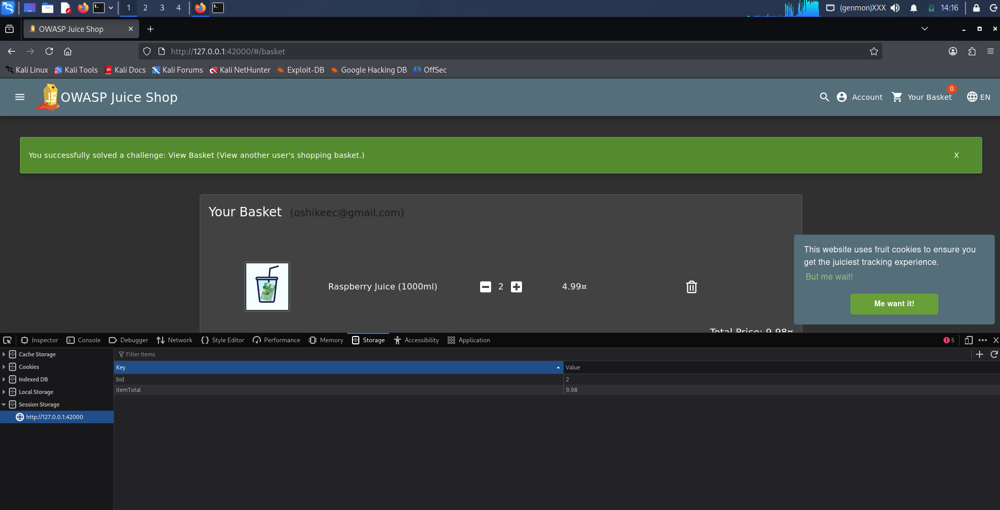

# View Basket

**Category:** Broken Access Control  
**Difficulty:** ⭐⭐  
**Assignee:** Emmanuel Oshike  
**Status:** [x] Completed  

## Objective
View another user's shopping basket.

## Tools Used
* Web browser (e.g., Firefox or Chrome)
* Browser Developer Tools (F12)

## Analysis & Approach
Modern web applications assign a unique identifier to objects, like a user's shopping basket. When you navigate to your cart, the frontend requests your specific basket ID from the backend API. An Insecure Direct Object Reference (IDOR) occurs when the application takes a user-supplied ID to retrieve an object but fails to verify if the currently authenticated user is actually authorized to view it. In Juice Shop, the active Basket ID (`bid`) is stored in the browser's Session Storage. By changing this ID to another number, we can trick the application into loading someone else's cart.

## Steps to Reproduce
1. Navigate to the Juice Shop homepage and log in to your account.
2. Add any item to your basket to ensure an active cart is created, then click on **Your Basket** to view it.
3. Open Developer Tools (press `F12` or right-click and select **Inspect**).
4. Navigate to the **Storage** tab (Firefox) or **Application** tab (Chrome).
5. Expand the **Session Storage** section and select `http://127.0.0.1:3000` (or `42000` depending on your setup).
6. Locate the key named `bid` (Basket ID). Its value will be a number representing your current cart.
7. Double-click the value of `bid` and change it to another number (e.g., `1`, `2`, or `3`).
8. Refresh the web page. 
9. The interface will now load and display the contents of another user's shopping basket, and the green success banner will appear.

## Proof of Concept (PoC)

**Payload Used:**
```text
Client-side Session Storage manipulation (changing the `bid` value from our assigned ID to `2`).
```

**Request/Response Snippet:**
```http
// Client-Side Session Storage Modification via Developer Tools
sessionStorage.setItem("bid", "2");

GET /rest/basket/1 HTTP/1.1
Host: localhost:42000
Authorization: Bearer <your_token>

HTTP/1.1 200 OK
Content-Type: application/json

{"status":"success","data":{"id":2,"UserId":2,"Products":[{"id":2,"name":"Apple Juice (1000ml)",...}]}}
```



## Root Cause & Remediation

**Why did this happen?**
The backend API endpoint (`/rest/basket/:id`) retrieves and returns the basket contents based purely on the `id` provided in the URL. It checks if the user is authenticated (they have a valid token), but it completely fails to check if the authenticated user's ID matches the owner of the requested basket.

**How to fix it:**
* Implement robust authorization checks at the data object level.
* When a request is made to `/rest/basket/:id`, the backend must query the database to confirm that the `UserId` associated with the requested `Basket` matches the `UserId` securely extracted from the requester's authenticated session token. If they do not match, the server should return a `403 Forbidden` error.
