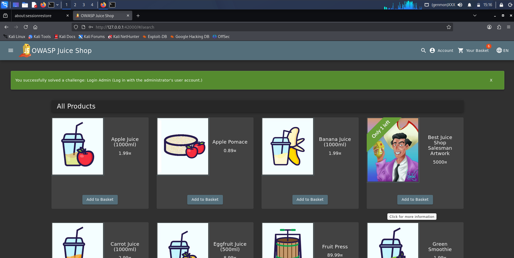

# Login Admin

**Category:** Injection  
**Difficulty:** ⭐⭐⭐  
**Assignee:** Emmanuel Oshike  
**Status:** [x] Completed  

## Objective
Log in with the administrator's user account.

## Tools Used
* Web browser

## Analysis & Approach
When a web application takes user input from a login form and inserts it directly into a backend database query without proper sanitization or parameterization, it becomes vulnerable to SQL Injection (SQLi). The Juice Shop login endpoint concatenates the provided email and password into a SQLite query. By supplying a crafted string containing SQL control characters (like single quotes `'` and comment markers `--`), an attacker can manipulate the logic of the query. Injecting `' OR 1=1 --` forces the database to evaluate the statement as true and ignores the password check entirely, returning the first user record in the database, which is typically the administrator.

## Steps to Reproduce
1. Navigate to the Juice Shop Login page (`/#/login`).
2. In the **Email** field, enter the following SQL injection payload: `' OR 1=1 --`
3. In the **Password** field, type any random character (e.g., `a`). The password does not matter because the SQL comment `--` will instruct the database to ignore it.
4. Click the **Log in** button.
5. The application bypasses the authentication check, logs you in as `admin@juice-sh.op`, and drops the green success banner.

## Proof of Concept (PoC)

**Payload Used:**
```sql
' OR 1=1 --
```

**Request/Response Snippet:**
```http
POST /rest/user/login HTTP/1.1
Host: localhost:42000
Content-Type: application/json

{"email":"' OR 1=1 --","password":"a"}

HTTP/1.1 200 OK
Content-Type: application/json

{"status":"success","data":{"token":"eyJhbG...","id":1,"email":"admin@juice-sh.op"}}
```



## Root Cause & Remediation

**Why did this happen?**
The backend Node.js code constructs the authentication SQL query using insecure string concatenation: 
`SELECT * FROM Users WHERE email = '` + req.body.email + `' AND password = '` + hash(req.body.password) + `'`
This allows the injected SQL characters in the email payload to alter the structural logic of the query itself.

**How to fix it:**
* Implement **Prepared Statements (Parameterized Queries)** for all database interactions. Instead of concatenating strings, the backend should define the SQL structure first and pass the user input as bound parameters. This ensures the database engine always treats the input as raw data, not executable code.
* Utilize a reputable Object-Relational Mapping (ORM) library that handles parameterization automatically.
